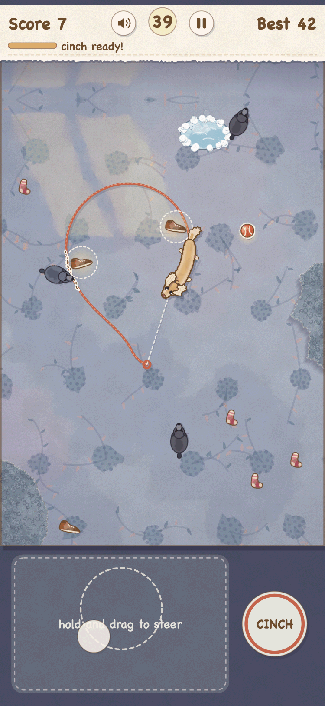
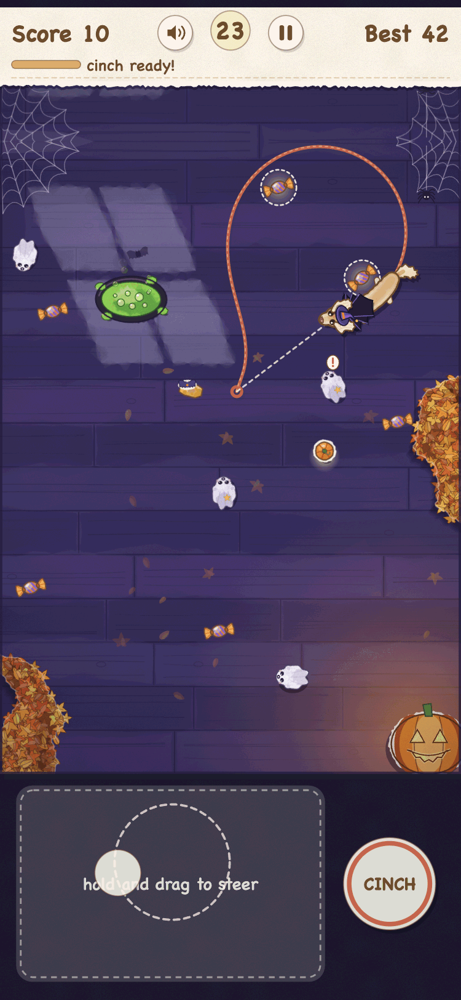
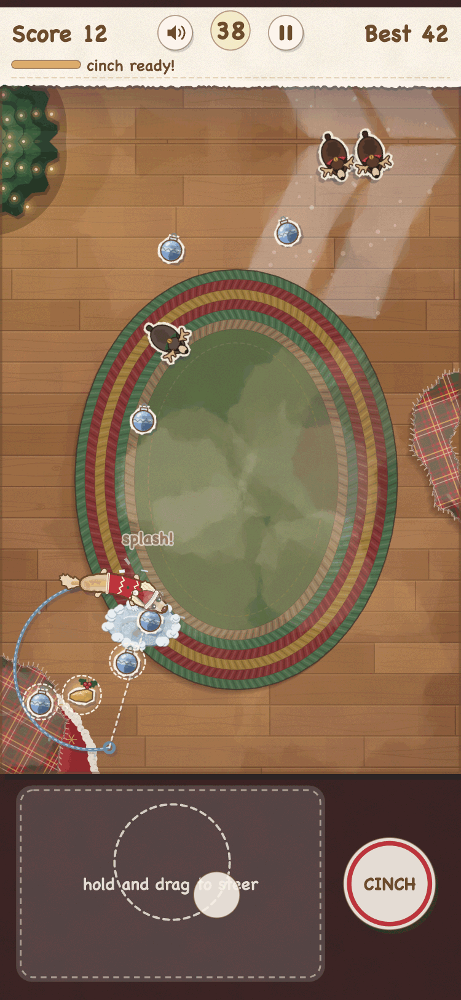
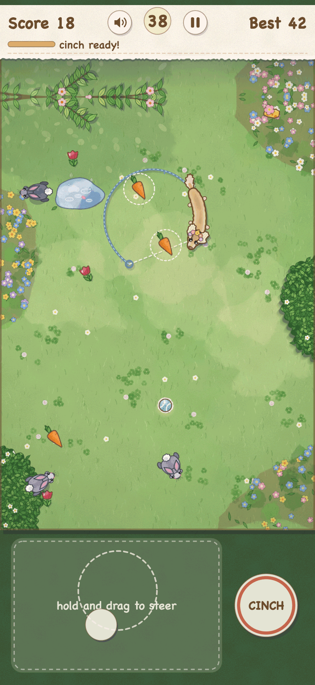
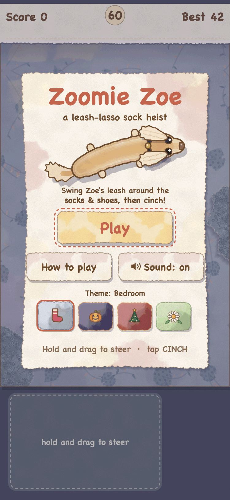

# Zoomie Zoe

*a leash-lasso sock heist*

**[Play now](https://vinayavc.github.io/zoomie-zoe/)**: https://vinayavc.github.io/zoomie-zoe/

Zoe is a mini long-haired dachshund with a very long body, very floppy ears and a habit of stealing socks. Steer her around the room while her leash trails behind her. Swing the leash in a loop around socks, shoes and cheese, then **cinch** it shut to scoop up everything inside. Bigger loops and quick chains score more.

Watch out for the other dogs. One bump and Zoe gets dizzy, and if one touches the leash, it snaps. Each round lasts 60 seconds. Beat your best score, then go again.

It works on phones, tablets and laptops, with no sign-up, no ads and no tracking.

## How to play

| | Steer Zoe | Cinch the loop | Pause | Sound |
|---|---|---|---|---|
| **Touch** | Hold and drag anywhere to steer (the pad below the room is the comfy spot) | Tap the **CINCH** button, or tap with a second finger | Pause button | Speaker button |
| **Mouse** | Move the mouse; Zoe follows it | Click | Pause button | Speaker button |
| **Keyboard** | Arrow keys or W A S D (Zoe heads toward that side). Hold **Shift** + an arrow to curve her into a loop | Space | Esc or P | M |

**Starting and restarting:** Space (or the Play button) starts a round. When a round ends, press **Play again**, Space or Enter. Taps on empty space don't restart, so a stray swipe won't throw away your score card.

**The cinch:** Zoe's leash follows the path she ran. Circle around some items so the leash makes a loop, then cinch. Everything inside the loop is hers. Keep other dogs off the leash while you're circling.

Zoe's extras: grab the ball for the zoomies, hide under the blankets, and dodge the bath.

## Four themes

Pick one on the title screen. The rules are the same in all four. Only the look and sound change.

- **Bedroom**: socks and shoes on the indigo bedspread. Zoe's home turf.
- **Spooky Night**: a moonlit room with candy and pumpkin pails. Cute-spooky, never scary.
- **Cozy Christmas**: ornaments and presents by the tree, with Zoe in a Santa hat.
- **Spring Garden**: tulips and carrots on the back lawn, with hopping bunnies to dodge.

## Install it and play offline

After your first visit, the game works without internet.

- **iPhone / iPad:** open the link in Safari, tap **Share**, then **Add to Home Screen**.
- **Android:** open the link in Chrome, tap the **⋮** menu, then **Install app** (or **Add to Home screen**).
- **Desktop (Chrome / Edge):** click the install icon at the right end of the address bar. In Safari on a Mac, use **File → Add to Dock**.

On iPhone, the home-screen app and Safari keep separate best scores.

## How it's made

Plain HTML, CSS and JavaScript with **no libraries and no frameworks**. **All the art is drawn in code**, the watercolor washes and paper cutouts included. There are no image files for the game art, and the sounds are synthesized live with the Web Audio API. Nothing loads from other websites.

## Run it locally

You need Python 3 (already on macOS).

```
python3 store/tools/dev-server.py
```

Then open **http://localhost:8742**. On `localhost` the offline service worker stays off, so code edits always show when you reload. To test offline mode, use http://127.0.0.1:8742 instead (see `docs/pwa-notes.md`).

The game lives in `src/`. The workflow in `.github/workflows/pages.yml` publishes `src/` to GitHub Pages.

## Screenshots

Phone screenshots, one per theme (from [`store/screenshots/`](store/screenshots/)):

<table>
  <tr>
    <td align="center"><br>Bedroom</td>
    <td align="center"><br>Spooky Night</td>
    <td align="center"><br>Cozy Christmas</td>
    <td align="center"><br>Spring Garden</td>
  </tr>
</table>



## Credits

Starring Zoe, Vinny's mini dachshund. Built with Claude Code.

The game's art, characters and code are original.
